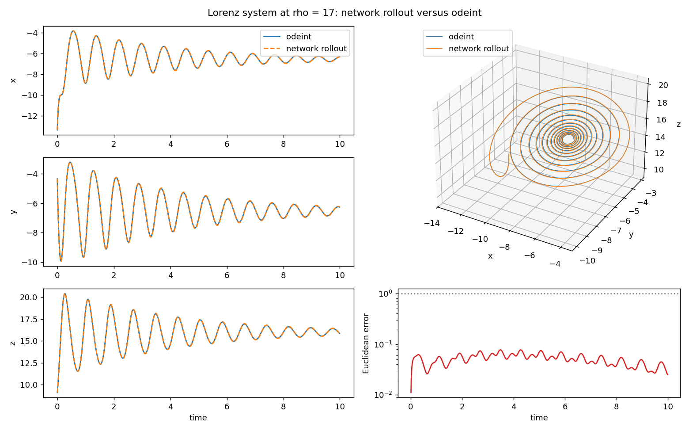
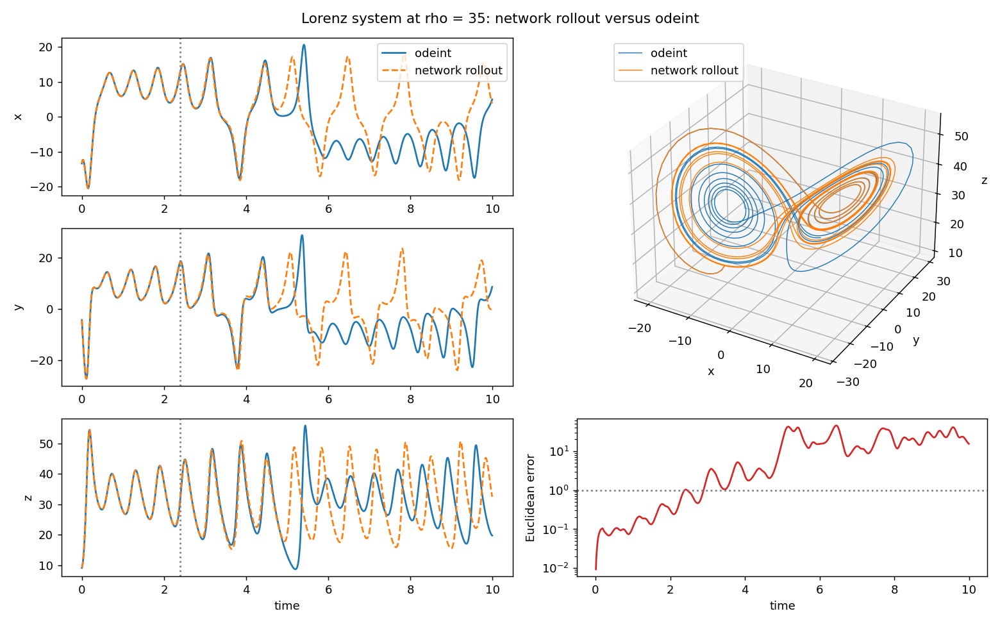

# Lorenz Neural Network

**Timeline:** July 2024 (rebuilt October 2026)

A Keras network learns the Lorenz system one time step at a time. It takes the state (x, y, z) and the parameter rho and predicts the state 0.01 time units later. It is trained on odeint trajectories at rho = 10, 28 and 40. It is then rolled forward on its own, with each prediction fed back in as the next input, from fresh starting points at rho = 17 and rho = 35, two values that are not in the training data. The rollouts are compared with odeint from the same starting points. At rho = 17, 16 of 20 rollouts stay within 1.0 of odeint for the whole 9.99 time units. At rho = 35 the system is chaotic and all 20 rollouts leave the true trajectory, first moving more than 1.0 away at a median of 3.06 time units.

## Results



Rollout at rho = 17 from a fresh starting point (seed 5000, the first of the 20 starts). The left column shows x, y and z over 9.99 time units for odeint (blue) and the network (dashed orange). The upper right panel shows the same trajectory in 3D. The lower right panel shows the Euclidean distance between the two on a log scale, with the error threshold of 1.0 as a dotted line. The distance never exceeds 0.077 and the rollout spirals toward a fixed point together with odeint.



Rollout at rho = 35 from the same starting point, in the same layout. The dotted vertical line marks the first time the error exceeds 1.0, at t = 2.39. That excursion is short: the error peaks at 1.03 and is back below 1.0 at t = 2.45. From t = 2.90 the error stays above 1.0 until the end of the run. It first exceeds 5 at t = 3.78 and 10 at t = 4.94, and the curves in the left column visibly separate by t = 5. The largest error is 45.4 and the final error is 15.4.

## How it works

The system is integrated with `scipy.integrate.odeint`, with sigma = 10 and beta = 8/3:

```
dx/dt = sigma (y - x)
dy/dt = x (rho - z) - y
dz/dt = x y - beta z
```

**Training set.** For each of rho = 10, 28 and 40 the script integrates 330 trajectories. Each starts from a point drawn uniformly from [-15, 15] in every coordinate and has 300 states at dt = 0.01, which is 2.99 time units. Each trajectory is cut into one-step pairs: the state at step i, with rho appended, is the input, and the state at step i + 1 is the target. Of the 330 trajectories per rho, 300 are for training and 30 are held out for validation. That gives 269,100 training pairs and 26,910 validation pairs.

**Network.** The input is (x, y, z, rho), standardised with the training mean and standard deviation. Three dense layers of 64 swish units follow. A final dense layer with 3 outputs gives a change in the state, which is added to the current (x, y, z) to produce the prediction. The network has 8,835 trainable parameters.

**Training.** The loss is the mean squared error on the next state. The optimizer is Adam with a cosine decay of the learning rate from 0.002 to 0.00002 over 40 epochs, with batch size 256. Validation uses whole trajectories that the network never trains on.

**Validation.** The final one-step validation MSE is 1.488e-06, in squared state units averaged over x, y and z. By training rho it is 3.197e-07 at rho = 10, 1.016e-06 at rho = 28 and 3.127e-06 at rho = 40.

**Rollouts.** Each rollout starts from a point drawn uniformly from [-15, 15] in every coordinate, produces 1,000 states (999 steps, 9.99 time units), and feeds the network's prediction back in as its next input. There are 20 starting points (seeds 5000 to 5019). Training and validation use seeds 0 to 989, and the network settings were chosen by comparing rollouts from seeds 1000 to 1019 (see Changes from the original submission), so seeds 5000 to 5019 played no part in training, validation or choosing the settings. The results below are the held-out result. odeint integrates the same starting points as the reference. The error at a step is the Euclidean distance between the network state and the odeint state. The figures show the first starting point, seed 5000.

- rho = 17: the error stays within 1.0 for all 9.99 time units in 16 of the 20 rollouts. The other four first exceed 1.0 at 0.33, 2.45, 2.98 and 3.27 time units. Three of those four peak at 1.02, 1.45 and 1.06, and the fourth reaches 35.96, which is the largest error over all starting points and steps. For the plotted rollout it is 0.077.
- rho = 35: none of the 20 rollouts stays within 1.0 for the full 9.99 time units. The error first exceeds 1.0 at a median of 3.06 time units, with a minimum of 0.95 and a maximum of 8.39. The largest error over all starting points and steps is 61.78. For the plotted rollout the first exceedance is at 2.39 time units and the largest error is 45.44.

The one-step error is small, but a rollout compounds it at every step. At rho = 35 the Lorenz system is chaotic, so two nearby trajectories separate exponentially, and a small error at each step grows along the rollout. At rho = 17 trajectories settle toward one of two stable fixed points, and most rollouts stay close to odeint. Four of the 20 do not.

## Run it

Requires Python 3.10 to 3.12, the versions with wheels for the pinned TensorFlow 2.16.2, NumPy 1.26.4 and Matplotlib 3.9.1.

```
python -m venv .venv
source .venv/bin/activate    # Windows: .venv\Scripts\activate
pip install -r requirements.txt
python -X utf8 lorenz_neural_network.py
```

On Windows, run it with `python -X utf8` so that Python's output encoding cannot fail on a non-ASCII character. Training prints two lines per epoch (`verbose=2`).

The script prints the validation errors and rollout results, writes `figures/rollout_rho17.png` and `figures/rollout_rho35.png`, and saves the trained network as `lorenz_network.keras`. NumPy and Keras are seeded with 0 and every starting point comes from a fixed seed. The figures and numbers above came from a run with Python 3.12.3 and the versions pinned in `requirements.txt` (TensorFlow 2.16.2, Keras 3.4.1, NumPy 1.26.4, SciPy 1.14.1 and Matplotlib 3.9.1) on Windows, using only the CPU. Reruns on that setup gave the same numbers and byte-identical figures. Other versions, or a different CPU math library, can change the last digits: with `TF_ENABLE_ONEDNN_OPTS=0` the rho = 28 validation error prints as 1.017e-06 instead of 1.016e-06, and the largest error of the plotted rho = 35 rollout as 45.438 instead of 45.435. A run takes between one and four minutes on a machine with 8 logical processors.

## Changes from the original submission

The original submission trained a Keras network at rho = 28 and plotted trajectories for rho = 17 and rho = 35. Two defects are fixed.

1. **Training at rho = 28 only.** The original network took (x, y, z) as input and was trained only on rho = 28 trajectories, so it had no way to represent rho = 17 or rho = 35. The network now takes rho as a fourth input and trains on rho = 10, 28 and 40.
2. **Discarded predictions.** In the original prediction loop, an odeint step overwrote every network prediction. The rho = 17 and rho = 35 plots therefore showed odeint output. The original measured only the one-step validation loss at rho = 28 that Keras printed after each epoch, and it never used the network's predictions at rho = 17 or rho = 35. The rollout now feeds the network's own predictions back in, and odeint is used only as the reference.

Other changes:

- **Data.** Five trajectories of 1,000 states at rho = 28 became 330 trajectories of 300 states at each of three rho values. The starting-point distribution, dt, sigma, beta and the one-step input and output slicing are unchanged.
- **Validation.** The original used `validation_split=0.2`, which holds out the last fifth of the rows. Validation now uses 30 held-out trajectories at each training rho, and the final one-step MSE is reported.
- **Network and training.** Two 32-unit ReLU layers became three 64-unit swish layers on standardised inputs, with the output added to the current state and a decaying learning rate. Training went from 60 epochs at batch size 32 to 40 epochs at batch size 256. These settings came from a few trial runs that compared validation error and rollout error. The rollout comparison used the starting points with seeds 1000 to 1019 at rho = 17 and rho = 35, so the results on those starting points are not an untouched test. The rollouts reported above use new starting points, seeds 5000 to 5019, which played no part in training, validation or choosing the settings.
- **Output.** Figures are saved to `figures/` instead of shown with `plt.show()`, and the model is saved in the `.keras` format instead of `.h5`. Keras is now seeded as well (the original seeded NumPy per trajectory), and `fit` and batch `predict` use `verbose=2`.

## Background

Coursework project, problem 6.5 in Rico Picone's Engineering Computing textbook.
